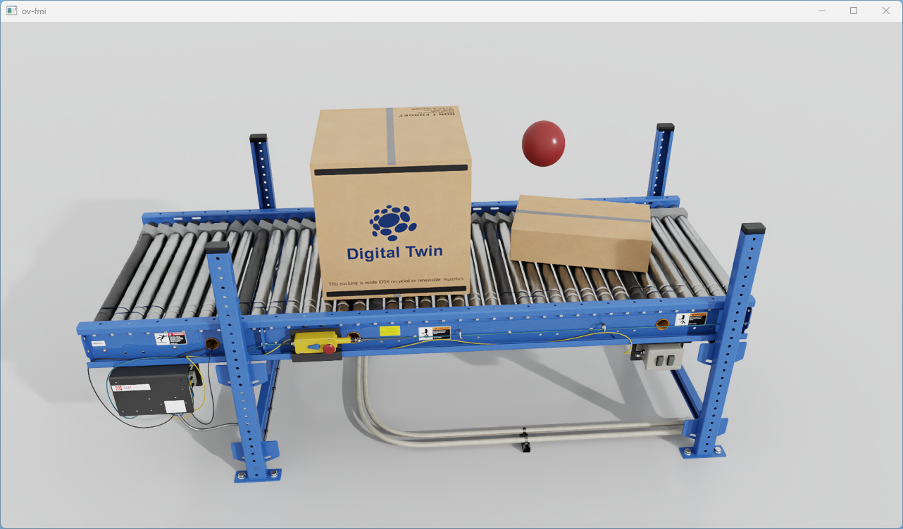

<!-- SPDX-FileCopyrightText: Copyright (c) 2026 NVIDIA CORPORATION & AFFILIATES. All rights reserved. -->
<!-- SPDX-License-Identifier: Apache-2.0 -->

# ovfmi — FMI and SSP Co-Simulation for OpenUSD Digital Twins

> Load FMI behavior models from an OpenUSD stage, step them with a native or FMPy runtime, and
> synchronize simulation data through a reusable Python API. The included
> standalone demo application renders with ovrtx and can close the loop with
> ovphysx rigid-body simulation. The project builds on the disaggregated
> Omniverse libraries and the open FMI, SSP, and OpenUSD standards.
>
> *Pre-release ovfmi 0.3.3 project. APIs and the USD-FMI schema may change.*



*The conveyor demo combines FMI control logic, ovphysx simulation, and ovrtx rendering.*

## Start Here

To evaluate ovfmi, follow **[Getting Started](#getting-started)** on this page.
It covers prerequisites, cloning, setup, and your first rendered demo.
You do not need to install the library separately first.

If you are integrating ovfmi into an existing application without the demo,
use [library-only setup](docs/library-only-setup.md) instead.

## Overview

### What Is ovfmi?

`ovfmi` is a reusable, USD-native library that adds behavior to industrial
digital twins by binding FMI co-simulation models to OpenUSD scenes through a
custom schema. USD describes world state; FMI and SSP supply simulation
behavior. ovfmi joins them so a USD layer can describe both the scene and its
simulation model in a form that remains readable and composable by USD tools.

Applications use the ovfmi Python API to discover `FmuInstance` and
`SspInstance` prims, instantiate models through either runtime, route
values between model variables and USD attributes, and advance the models.
The `demoapp/` directory is separate sample code that shows how to combine the
library with ovstage, ovrtx rendering, and optional ovphysx simulation without
requiring a full Omniverse Kit installation.

### What Functionalities Are Available, and Who Are the Target Users?

Available functionality includes:

- Declaratively embedding individual FMUs and packaged SSP systems in USD.
- Running FMI 2.0 and FMI 3.0 Co-Simulation models through either a native
  Rust/fmi-rs backend or the Python FMPy backend, using the same public API.
- Preparing supported SSP 1.0 systems as native container FMUs with FMPy at
  build time. Native FMI execution does not import FMPy or embed Python.
- Mapping FMI variables to USD attributes, including selected vector
  components and ranges.
- Deterministic, synchronous simulation stepping and explicit data routing
  through a documented Python API.
- Integrating FMU control logic with ovphysx rigid bodies in the sample
  application, using shared ovstage data rather than per-attribute USD I/O.
- Running the supplied examples with live ovrtx rendering or in headless mode.

ovfmi is intended for:

- Industrial digital-twin engineers adding controllers, sensors, and actuator
  behavior to OpenUSD scenes.
- Controls and simulation engineers bringing vendor-neutral FMUs and SSPs into
  USD-based workflows.
- Robotics and physics developers coupling model-based control logic to
  rigid-body simulations.
- Independent software vendors and integrators assembling standards-based simulation applications.

FMI means *Functional Mock-up Interface*. An FMU is a *Functional Mock-up Unit*,
the packaged model that an FMI runtime loads. SSP means *System Structure and
Parameterization*. OpenUSD is *Universal Scene Description*.

### Two Runtime Alternatives

Select `native` (the default) for Rust/fmi-rs FMI execution, or `fmpy` for the
Python FMPy master. Both use the same public Python API and support the supplied
examples. Native execution does not embed Python, but the public binding,
USD routing, and demo application remain Python.

Native SSP execution uses a container FMU prepared with FMPy at build time.
The backends use different coupling schedules, so trajectories need not be
identical. Refer to [supported models and execution differences](docs/native-runtime-poc.md)
before integrating your own models.

## Requirements

### Library Requirements

The Python library supports Python 3.10–3.13 on Windows x64 and Linux x86-64.
Linux wheels require glibc 2.28 or newer. Stage integration needs ovstage and
an isolated OpenUSD helper environment. Source builds also require Rust/Cargo
and a platform C linker; platform wheels include the native library.

The library does not require an NVIDIA GPU or a renderer.
[Library-only setup](docs/library-only-setup.md) covers that separate use case.

### Demo Application Requirements

For the rendered demos, you need an NVIDIA RTX GPU with a compatible driver,
a display with OpenGL support, Git LFS, Python, Rust, and a C++17 compiler.
The platform-specific steps below cover these prerequisites.
Setup installs ovstage, ovrtx, ovphysx, and the Python dependencies for you.

The current demo still initializes ovrtx with `--headless`, so that option
removes the window requirement, **not the RTX GPU requirement**.
With optional CUDA bindings and a compatible CUDA runtime, the viewer maps
rendered RGBA frames to CUDA memory and copies them directly to an OpenGL
texture. The viewer selects the display's CUDA device for rendering. This route
avoids CPU readback but still performs a GPU-to-GPU copy.

Without CUDA bindings, or if CUDA mapping or interop fails, the viewer tries
CPU readback and OpenGL upload for the remaining frames. It reports the
fallback reason after the first successful CPU presentation. If CUDA resource
cleanup or OpenGL upload fails, presentation stops with an error.
CPU display does not require the CUDA Toolkit or `cuda-python`.
Headless verification and PNG output use CPU mapping.

## Getting Started

Follow **one** platform section from beginning to end. Both routes build ovfmi,
prepare the example models, and run the conveyor using the pinned NVIDIA packages and `native` FMI backend. No separate library installation
or virtual-environment activation is needed.

For the clone command, replace `<repository-url>` with the HTTPS clone URL
from **Code > HTTPS** on the GitHub repository containing this README.
This keeps the instructions usable for both development and release checkouts.
A private repository requires GitHub access; resolve an authorization error
before proceeding. If you already have a checkout, use that directory and
run `git lfs pull` there instead of cloning again.

### Windows

#### 1. Install Prerequisites

Install the following tools:

- [NVIDIA graphics driver](https://www.nvidia.com/Download/index.aspx) compatible with your RTX GPU.
- [Python 3.10–3.13](https://www.python.org/downloads/), including the `py` launcher and the option to add Python to PATH.
- [Git for Windows](https://git-scm.com/download/win) and [Git LFS](https://git-lfs.com/).
- [Visual Studio Build Tools](https://visualstudio.microsoft.com/downloads/#build-tools-for-visual-studio-2022), with **Desktop development with C++** and **MSVC v143 x64/x86 build tools**.
- [Rust through rustup](https://rustup.rs/), using its Windows MSVC toolchain.

Open a new, normal PowerShell after installation. Confirm that both `py` and
`python` select a supported Python version, and that Cargo is available:

```powershell
py --version
python --version
cargo --version
git lfs version
```

Each command must report a version. If Python opens the Microsoft Store or
either Python version falls outside 3.10–3.13, correct your Python installation
or PATH before continuing. Setup uses both commands.
You do not need a Visual Studio developer prompt; setup locates `vcvars64.bat`
for the model build.

#### 2. Clone the Repository and Fetch Assets

From the directory where you keep projects, run the following commands after
replacing `<repository-url>` with the repository's **Code > HTTPS** clone URL:

```powershell
git lfs install
git clone <repository-url> ovfmi
cd ovfmi
git lfs pull
```

The commands must finish without errors. Git LFS downloads the conveyor geometry
and textures in development checkouts. Public snapshots include these as ordinary files.

#### 3. Run Setup

From the repository root, run:

```powershell
powershell -ExecutionPolicy Bypass -File demoapp\setup.ps1
```

To enable the CUDA display attempt, install optional `cuda-python` bindings
with this variant. Compatible CUDA runtime libraries are also required:

```powershell
powershell -ExecutionPolicy Bypass -File demoapp\setup.ps1 -InstallCudaPython
```

Setup creates `demoapp/.venv` for the application and `demoapp/.usd_venv` for
isolated OpenUSD parsing. It installs the pinned NVIDIA packages, builds
the native library and demo FMUs, and prepares the SSP containers.
It also writes `demoapp/.env` with the runtime paths. It does not change
global or user-installed Python packages.

Wait for setup to finish successfully. Its output should report
`NVIDIA runtime packages:` followed by the installed versions. If it fails, resolve the reported error
before running a demo.

#### 4. Launch the Conveyor

In the same repository directory, run:

```powershell
.\demoapp\.venv\Scripts\python.exe demoapp\main.py demoapp\usd\conveyor\ConveyorFMI.usda --up-axis Z
```

Continue with [Verify the Demo](#verify-the-demo) below for expected behavior
and controls.

### Linux

#### 1. Install Prerequisites

Use an x86-64 machine with an RTX GPU, a compatible
[NVIDIA graphics driver](https://www.nvidia.com/Download/index.aspx), and a
working graphical desktop. Install [Rust through rustup](https://rustup.rs/).

On Ubuntu or Debian, install the remaining tools and display libraries:

```bash
sudo apt update
sudo apt install -y \
  git git-lfs \
  python3 python3-venv python3-pip \
  build-essential \
  libgl1 libx11-6 libxrandr2 libxinerama1 libxcursor1 libxi6
```

For other distributions, install the equivalent packages.
Open a new terminal after installing Rust, then check the tools:

```bash
python3 --version
cargo --version
c++ --version
git lfs version
```

Each command must report a version. `python3` must select Python 3.10–3.13.
If your distribution's default is outside that range, select a supported
Python installation before running setup.

#### 2. Clone the Repository and Fetch Assets

From the directory where you keep projects, run the following commands after
replacing `<repository-url>` with the repository's **Code > HTTPS** clone URL:

```bash
git lfs install
git clone <repository-url> ovfmi
cd ovfmi
git lfs pull
```

The commands must finish without errors. Git LFS downloads the conveyor geometry
and textures in development checkouts. Public snapshots include these as ordinary files.

#### 3. Run Setup

From the repository root, run setup as your normal user, not with `sudo`:

```bash
bash demoapp/setup.sh
```

To enable the CUDA display attempt, install optional `cuda-python` bindings
with this variant. Compatible CUDA runtime libraries are also required:

```bash
INSTALL_CUDA_PYTHON=1 bash demoapp/setup.sh
```

Setup creates `demoapp/.venv` for the application and `demoapp/.usd_venv` for
isolated OpenUSD parsing. It installs the pinned NVIDIA packages, builds
the native library and demo FMUs, and prepares the SSP containers.
It also writes `demoapp/.env` with the runtime paths. It does not change
global or user-installed Python packages.

Wait for setup to finish successfully. Its output should report
`NVIDIA runtime packages:` followed by the installed versions. Setup handles an unwritable default Cargo
cache automatically unless custom configuration needs to be preserved; in
that case, follow its `CARGO_HOME` instructions and rerun setup.

#### 4. Launch the Conveyor

In the same repository directory, run:

```bash
demoapp/.venv/bin/python demoapp/main.py demoapp/usd/conveyor/ConveyorFMI.usda --up-axis Z
```

Continue with [Verify the Demo](#verify-the-demo) for expected behavior and controls.

### Verify the Demo

A live window opens. Startup and the first frame can take several minutes on a
cold cache while ovrtx loads resources and compiles shaders. The window can
remain blank during this work. The `[startup]` messages identify the pending
operation; they do not measure shader-compilation progress.

Expect brown boxes moving on the conveyor and a
direction reversal when the sensor activates. The console reports
`Renderer ready`, `ovfmi attached 1 instance(s)`, and `Running simulation`.
After the first frame is presented, the log reports
`GPU display: CUDA/OpenGL GPU copy (no CPU readback)` or
`GPU display: CPU readback and OpenGL upload` with the fallback reason.
A successful switch to CPU display after a later CUDA failure is also reported.
RTX rendering still runs on the GPU in either case.
Close the window or press Ctrl+C to stop.

Use these controls to inspect the scene:

- W/A/S/D: move.
- Q/E: move down or up.
- Right mouse drag: look around.
- Shift: move faster.
- Ctrl: move slower.

If setup fails, startup never completes, or the scene differs from this
description, use [troubleshooting](docs/troubleshooting.md). Include the last
`[startup]` message and subsequent logs in a problem report.

## Try More Examples

After the conveyor works, run another scene from the repository root.
Run one command at a time and close its window before starting the next.

On Windows, use these commands:

```powershell
# Bouncing ball: one FMU drives the sphere height.
.\demoapp\.venv\Scripts\python.exe demoapp\main.py demoapp\usd\fmi_parser_test.usda

# Proportional–derivative controller: physics feedback drives a body.
.\demoapp\.venv\Scripts\python.exe demoapp\main.py demoapp\usd\pd_controller_test.usda

# Two FMUs exchange values through USD to produce orbit motion.
.\demoapp\.venv\Scripts\python.exe demoapp\main.py demoapp\usd\two_fmu_orbit.usda

# An SSP packages the orbit model's internal FMU connections.
.\demoapp\.venv\Scripts\python.exe demoapp\main.py demoapp\usd\ssp_orbit.usda
```

On Linux, use these commands:

```bash
demoapp/.venv/bin/python demoapp/main.py demoapp/usd/fmi_parser_test.usda
demoapp/.venv/bin/python demoapp/main.py demoapp/usd/pd_controller_test.usda
demoapp/.venv/bin/python demoapp/main.py demoapp/usd/two_fmu_orbit.usda
demoapp/.venv/bin/python demoapp/main.py demoapp/usd/ssp_orbit.usda
```

The [example catalog](examples/README.md) links the scene files and explains
their behavior. It is reference material, not an additional setup step.

### Compare FMI Backends

Setup prepares both backends. Each command defaults to `--backend native`.
Append `--backend fmpy` to run the same scene with the Python master;
no other command changes are needed. For example, on Windows:

```powershell
.\demoapp\.venv\Scripts\python.exe demoapp\main.py demoapp\usd\conveyor\ConveyorFMI.usda --up-axis Z --backend fmpy
```

On Linux, run:

```bash
demoapp/.venv/bin/python demoapp/main.py demoapp/usd/conveyor/ConveyorFMI.usda --up-axis Z --backend fmpy
```

Native and FMPy coupling schedules differ, so trajectories need not be identical.
Refer to [backend support and numerical differences](docs/native-runtime-poc.md)
before using your own models.

### NVIDIA Dependencies

Both FMI backends use the same supported NVIDIA library combination.
Setup installs these exact versions from [requirements.txt](demoapp/requirements.txt):

| Package | Version |
|---|---|
| ovstage | `0.4.0.1794520352` |
| ovrtx | `0.7.0.1794596436` |
| ovphysx | `0.8.0.43443703471` |
| physx-usd-schemas | `25.11.2.72696984` |

The demo registers the separate PhysX schema data package before populating
the stage; no manual schema import is needed. Older library combinations and
the former validated/experimental setup profiles are no longer supported.

Close running demos before rerunning setup. Setup refreshes the existing
demo environment without deleting its local files or changing global Python
packages. Startup reports installed versions and warns if they differ from
the supported pins. Pip uses its configured index; `PIP_FIND_LINKS` can point
to matching local wheels. Optional CUDA bindings work with the normal setup
commands above.

### Build Options

The normal setup builds the native runtime and all example models.
These options are useful for alternative or repeated setups:

| Purpose | Windows Setup Option | Linux Setup Environment Variable |
|---|---|---|
| Build only the FMPy backend, without requiring Rust | `-SkipNativeBuild` | `SKIP_NATIVE_BUILD=1` |
| Reuse existing model archives instead of compiling FMUs and SSPs | `-SkipFmuBuild` | `SKIP_FMU_BUILD=1` |

After skipping the native build, run demos with `--backend fmpy`; there is no
automatic fallback. A C++17 compiler is still required to build the models.
Only skip model compilation if the generated archives already exist for your
platform; that option cannot make a fresh checkout runnable.

### Headless Verification

After [standard setup](#getting-started), use a bounded run to check
startup without opening a window. **An RTX GPU is still required** because the
demo still initializes ovrtx. `--duration` limits simulation time, not startup time.

On Windows, run:

```powershell
.\demoapp\.venv\Scripts\python.exe demoapp\main.py demoapp\usd\conveyor\ConveyorFMI.usda --up-axis Z --duration 0.05 --headless
```

On Linux, run:

```bash
demoapp/.venv/bin/python demoapp/main.py demoapp/usd/conveyor/ConveyorFMI.usda --up-axis Z --duration 0.05 --headless
```

Success means exit code zero and output containing these prefixes:

```text
ovfmi attached 1 instance(s)
FMI physics controls: shared ovstage control ordinals
Done:
```

This short check verifies startup, not long-running physics correctness.
For failures, refer to [troubleshooting](docs/troubleshooting.md).

## Command Reference

Use these flags to configure a demo run:

| Flag | Description |
|---|---|
| `--backend native` / `--backend fmpy` | Select the FMI master. Default: `native`. Applies to every demo. |
| `--headless` | Run without a display window. |
| `--png` | Save rendered frames as PNG images to `_output/`; implies `--headless`. |
| `--duration SECONDS` | Stop after a fixed simulation time. Default is infinity. |
| `--no-physics` | Render authored transforms without starting ovphysx. |
| `--up-axis Y\|Z` | Override stage up-axis inference. |
| `--nav-speed VALUE` | Live viewer movement speed. |
| `--mouse-sensitivity VALUE` | Mouse-look sensitivity in degrees per pixel. |
| `--render-product PATH` | Render product prim path. Default: `/Render/Camera`. |
| `--camera-prim PATH` | Camera prim controlled by live navigation. |

## Documentation and Reference Links

The [documentation index](docs/README.md) organizes setup, concepts, reference,
troubleshooting, and contributor instructions. The following references cover
the project and its standards:

- [Changes from 0.2 to 0.3](CHANGES.md)
- [USD-FMI Schema Reference](docs/USD-FMI-SCHEMA.md)
- [Architecture and API design](docs/architecture.md)
- [Runtime backends, supported features, and execution differences](docs/native-runtime-poc.md)
- [FMI standard](https://fmi-standard.org/)
- [SSP standard](https://ssp-standard.org/)
- [OpenUSD](https://openusd.org/)
- [fmi-rs native FMI runtime](https://github.com/CATIA-Systems/fmi-rs)
- [FMPy runtime and SSP/container build tooling](https://github.com/CATIA-Systems/FMPy)
- GTC 2025 session S71963, "Build Physics-Based Digital Twins for
  Co-Simulation" (with SoftServe), which presents the original project.

## Releases

The source tree describes ovfmi 0.3.3. Refer to [changes from 0.2 to 0.3](CHANGES.md)
and [runtime compatibility](#nvidia-dependencies).
Release wheels contain the native shared library; installing a wheel does not
require Rust. The source checkout is the setup route documented here;
do not assume that a matching prerelease wheel is available on PyPI.

## Known Issues

- Custom USD-FMI discovery requires the original USD source and an isolated OpenUSD helper because ovstage does not expose those schemas.

Refer to [troubleshooting](docs/troubleshooting.md) for diagnosis and recovery.

## Support

Report reproducible problems through this repository's GitHub Issues, or ask in
the [NVIDIA Omniverse developer forum](https://forums.developer.nvidia.com/c/omniverse/300).
Include the ovfmi version, operating system, FMI backend, NVIDIA package versions, exact
command, and relevant logs. Remove credentials and private model data first.
For security vulnerabilities, follow the [security policy](SECURITY.md) instead
of opening a public issue.

## Contributing

See the [contribution policy](CONTRIBUTING.md).
Maintainers use [development and testing instructions](docs/development.md)
to validate changes. Keep runtime behavior separate from demo presentation changes.

## License

The ovfmi source code is licensed under the [Apache License 2.0](LICENSE.md).
The SimReady-derived conveyor and box assets are licensed under
[Creative Commons Attribution 4.0 International (CC BY 4.0)](https://creativecommons.org/licenses/by/4.0/).
See their [attribution and modification notice](demoapp/usd/conveyor/ATTRIBUTION.md)
and the [third-party notices](THIRD_PARTY_NOTICES.md) for separate component terms.

The `native/licenses/defmt-parser-1.0.0/` directory preserves upstream
defmt-parser 1.0.0 license texts: [Apache License 2.0](native/licenses/defmt-parser-1.0.0/LICENSE-APACHE)
and [MIT License](native/licenses/defmt-parser-1.0.0/LICENSE-MIT), with the
original Ferrous Systems attribution preserved. See the recorded
[upstream provenance](native/licenses/defmt-parser-1.0.0/provenance.json).
