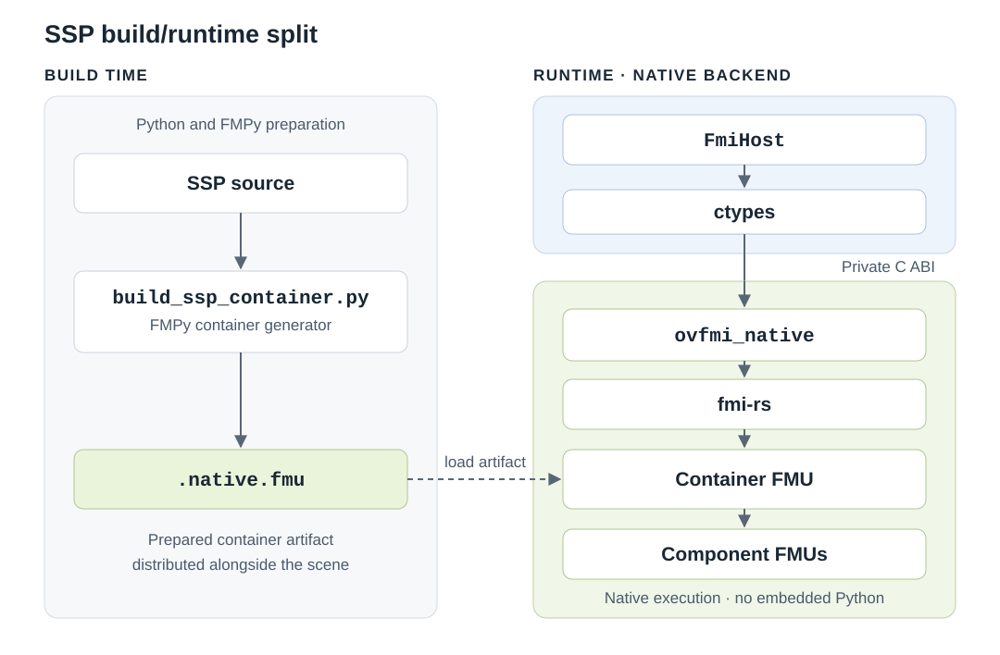

<!-- SPDX-FileCopyrightText: Copyright (c) 2026 NVIDIA CORPORATION & AFFILIATES. All rights reserved. -->
<!-- SPDX-License-Identifier: Apache-2.0 -->

# Native and FMPy Runtime Backends

The native runtime now executes all supplied behavior examples: bouncing ball,
PD controller, two-FMU orbit, SSP orbit, and conveyor. The historical filename
of this document is retained for existing links.

Applications use the same [public Python API](api.md) for both alternatives.
Set `FmiHostConfig(backend="native")` (the default) or
`FmiHostConfig(backend="fmpy")` when constructing the host.

The demo exposes this choice as `--backend native|fmpy`. Selection is explicit:
an unavailable backend raises an error rather than silently switching masters.

## Execution Boundary

The native backend loads FMUs, manages their lifecycle, accesses their values,
and steps them in Rust through fmi-rs. There is no embedded Python interpreter
or FMPy import in this execution path. Its private C ABI also works without the
Python binding (refer to [the native header](../native/include/ovfmi_native.h)).

The public binding, USD-space routing, graphical application, and isolated
OpenUSD schema-discovery helper remain Python. This is a native FMI execution
alternative, not yet an entirely native USD-facing library or a public C
equivalent of every `FmiHost` method.

The FMPy backend retains the Python master and direct SSP loading. Neither
backend owns rendering or physics: the demo connects the same public API to
ovstage, ovrtx, and ovphysx.

## Supported Native Models

- FMI 2.0 and FMI 3.0 **Co-Simulation**, with scalar Real/Float64 routing.
- FMU ZIP archives and unpacked FMU directories, including the examples'
  `.fmu3` directories. The XML version, not the extension, selects the loader.
- Multiple model instances and USD component mappings.
- Authored start values, with FMI 2 inputs applied in Initialization Mode and
  other values applied before initialization. Stepping is synchronous; reset
  restores time zero and authored inputs; release is deterministic.
- SSPs prepared as container FMUs using the build-time converter below.

This is not an unrestricted FMI implementation: Model Exchange, Scheduled
Execution, FMI 1, non-real routing, FMI array variables, external FMI 3 event
handling, and early return are not supported by the native bridge. Unsupported
types or step responses produce explicit errors. Scalar variables may still
map to components of USD vectors and matrices, as the demos do.

Both hosts reset their own FMUs and routing state only. A caller must reset
external physics and stage state separately when restarting a coupled system.

## SSP Build/Runtime Split

The native backend separates SSP preparation from model execution:

*FMPy prepares the container at build time. The public binding remains Python,
while the container and its component FMUs execute natively.*

`demoapp/build_fmu.py` generates both the authoring `.ssp` and its prepared
`.native.fmu` for conveyor and orbit. Native execution derives the prepared
path from the authored SSP reference and does not import FMPy. Package both
artifacts alongside the scene. The FMPy backend uses the original `.ssp`.

Conversion supports the flat component/connection subset used by these
examples, with scalar Real FMI 2 components. Nested systems, parameter sets,
transformations, signal dictionaries, and general SSP validation are not
implemented. Arbitrary SSP support is not implied by either example master.

The converter rejects direct system-input-to-system-output connections with
a `ValueError` explaining the unsupported topology, before connection resolution
or container generation. This rejection does not modify an existing output FMU.

### Coupling and Numerical Differences

The native container propagates internal connections after stepping all its
components. The Python sequential SSP master propagates after each component.
A native SSP therefore has a communication-step coupling delay relative to
the Python master. This affects transient trajectories, not just performance.
The sample controllers work with either schedule, but they should not be
expected to produce bit-identical traces. Select and validate a communication
step appropriate to a model before using it for control or analysis.

Individual native FMUs receive one `doStep` per host step. FMPy's simulation
driver can subdivide that interval. Numerical trajectories can therefore also
differ slightly for standalone FMUs even with identical public step sizes.

## Build and Dependencies

The standard demo setup builds both alternatives. For a FMPy-only setup use
`-SkipNativeBuild` on Windows or `SKIP_NATIVE_BUILD=1` on Linux; Rust is then
unnecessary. Run those demos with `--backend fmpy`.

For library-only prerequisites, installation, and native library discovery,
follow [library-only setup](library-only-setup.md). Platform wheels bundle the
shared library; an editable installation uses the local Cargo build.

The native dependency remains unmodified fmi-rs 0.3.5 at commit
`99b9a6011abae49a6e191918cde9fe49e100562d`, with the resolved graph in
`native/Cargo.lock`. FMPy is pinned to 0.3.32 for reproducible preparation and
Python execution.

FMPy's container generator currently requires two metadata normalizations in
`tools/build_ssp_container.py`:

- Internal FMI 2 connection type `Real` becomes the container's `Float64`.
- Outer FMI 2 value references become one-based rather than zero-based.

The runtime DLL/shared library inside the generated container is the **stock**
one shipped by FMPy. There is no local FMPy or fmi-rs fork. FMPy 0.3.32 contains
the floating-point fixed-step validation fix previously needed by conveyor.

## Validation

After [demo setup](../README.md#getting-started), run the
[CPU integration tests](development.md#testing) with the demo environment's
Python executable. They exercise all five behavior scenes with both backends,
test reset/replay, check conveyor controls, and forbid FMPy imports in native
execution. These tests do not require a GPU.

`cargo test --manifest-path native/Cargo.toml --release --locked` additionally
executes the bouncing-ball FMU and conveyor container from a Rust test binary,
without any Python process. Build the example models before running it.

For the real renderer and physics path, set `OVFMI_TEST_RENDER=headful` or
`headless` and run `python -m pytest demoapp/tests/test_backend_rendering.py`.
This opt-in matrix runs each scene with both backends. Headful needs a display;
both modes need RTX. Refer to [GPU testing](development.md#testing) for platform-specific commands.
